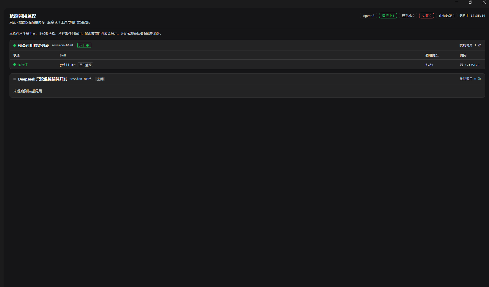

# @yyc-jnu/dsh-skill-invocation-monitor

[English](README.md) | **简体中文**

[](https://www.npmjs.com/package/@yyc-jnu/dsh-skill-invocation-monitor)
[](LICENSE)
[](https://github.com/YYC-JNU/dsh-skill-invocation-monitor)

> 一个**只读**的 [DeepSeek Harness](https://github.com/deepseek-ai/deepseek-harness)（DSH）插件，把技能调用摊在一屏里：
> 当前有哪些 Agent 在跑、每个正在调用哪个 Skill、是运行中 / 已完成 / 失败、已经跑了多久——在 Web GUI 侧边栏实时可见。



*取自运行中的插件：点侧边栏入口打开面板，每个 Agent 一组，每一行是一次技能调用（状态、时长、起始时刻）。*

## 装完之后你会得到什么

DSH 里的技能调用是隐形的。模型读了某个技能，你只看到结果——看不到那次调用、看不到耗时、更看不到那个
一直没回来的。装上这个插件之后：

- 侧边栏多一个 **技能监控** 入口，图标上带一个**运行中调用数**的实时徽标；
- 面板列出每个活动 Agent，以及它下面每一次技能调用的**状态**与**时长**；
- 技能的两条到达路径**都**被覆盖且可区分：模型调用 `skill` 工具，以及**你**自己触发的技能（那一行带 `用户触发` 标记）；
- 全程不写任何东西：不注册工具、不改会话状态、不拦截也不延缓任何调用。

## 安装

```sh
# 从 npm 安装（推荐：装到的是预构建产物，不需要任何构建脚本授权）
dsh plugin --profile web add @yyc-jnu/dsh-skill-invocation-monitor

# 或直接从 GitHub 安装（纯 ESM JavaScript，没有构建步骤，pnpm 不会要求 allowBuilds）
dsh plugin --profile web add github:YYC-JNU/dsh-skill-invocation-monitor
```

然后**重启 DSH 并刷新页面**。两个半（宿主的只读观察器与路由、浏览器 bundle）都在宿主启动时扫描，
所以重启之前侧边栏不会出现入口。

启动前可先验证层是否生效：

```sh
dsh --profile web --dump-config     # 应看到: # == @yyc-jnu/dsh-skill-invocation-monitor
```

如果这一层不存在，说明包只作为普通依赖装上了，插件并未激活。

卸载：

```sh
dsh plugin --profile web remove @yyc-jnu/dsh-skill-invocation-monitor
```

## 功能

| | |
|---|---|
| 实时 Agent 列表 | 每个活动 Agent、它的会话标题，以及它是运行中还是空闲 |
| 每次调用一行 | Skill 名、状态（`运行中` / `已完成` / `失败` / `未观测到结果`）、时长、起始时刻 |
| 两条调用路径 | 模型的 `skill` 工具调用，以及人手动触发的技能——后者标 `用户触发` |
| 时长实时跳动 | 运行中的调用每秒刷新一次时长 |
| 侧边栏徽标 | 运行中计数直接挂在侧边栏入口上，不打开面板也能看出有没有活动 |
| 如实呈现失败 | 失败的调用附带截断后的原因，例如 `skill "…" is unknown or no longer available` |
| 自检诊断 | 每次响应都带一组计数，描述插件实际看到了什么，让错误假设**可见而不是静默** |
| 零依赖 | 两个半都不 import 任何第三方包（浏览器半只用宿主模块表里的 `react`） |

## 权限与数据

这个插件存在的意义就是观察，它的全部设计都围绕"不参与"。

| | |
|---|---|
| 观察（只读） | 五个 Cordis 事件：`tools/pre-execute`、`tools/result`、`session/event`、`agent/status`、`agent/disposed` |
| 读取 | 活动 Agent 列表、会话标题、以及边落盘边推送的会话事件流 |
| **不**写入 | 不写会话状态、不写 session log、不落盘、不写配置、不注册工具、不注册命令 |
| **不**干预 | `tools/pre-execute` 监听器原样返回 `next()`，从不拒绝/取消/改写/延缓任何调用；每个观察器都整体包裹，插件自身的 bug 无法破坏工具派发 |
| HTTP 面 | 只有一条路由 `GET /api/plugins/skill-monitor/state`——无请求体、无写操作、`cache-control: no-store` |
| 网络暴露 | 仅回环：非回环来源、跨站标记或外部 `Origin` 一律 `403`；非 GET 方法一律 `405` |
| 数据在哪 | 宿主内存里的一个 `Map`。记录有上限（默认 200）并按时间淘汰（结算后 10 分钟）；重启 DSH 即清空 |
| 不收集 | 提示词正文、模型输出、文件内容、凭据，以及任何插件根本没有读的东西 |

## 兼容性

| | |
|---|---|
| DSH | 在 **0.2.0-rc.2** 上验证通过（本插件的开发与测试环境）。所用接缝均为官方核心面，预期其他 0.2.x 构建同样可用 |
| Node.js | 声明 `>=20`。插件运行在 DSH 宿主内，实际以宿主自身的 Node 要求为准 |
| 界面 | Web GUI（`dsh.client.platform: "web"`）。只用官方 Slot——入口用 `sidebar.panellist`，面板用 `main`——不做任何 DOM 注入 |
| 技能路径 | 两条路径都走持久化契约：工具调用走 `tools/pre-execute` / `tools/result`；人的调用走技能接缝声明的 `skill-invocation` 消息来源 |

## 工作原理

<details>
<summary><b>两条调用路径</b>——以及为什么人这条是读消息来源</summary>

技能在 DSH 里有两种结构性完全不同的到达方式，插件两条都观察。

| | 模型路径 | 用户路径 |
|---|---|---|
| 触发 | 模型调用 `skill` 工具 | 你在会话里调用一个技能（例如 `/grill-me`） |
| DSH 的行为 | 走工具流水线并产生工具结果 | 把技能正文作为一条 `user/message` 追加进对话——**既不产生工具调用，也不产生命令事件** |
| 配对键 | `callId` | 该消息的 `id` |
| 时长口径 | `tools/result` − `pre-execute` | `turn/end` − 注入时刻（见下） |
| 行内标记 | 无 | `用户触发` |

人这条路径读的是技能接缝自己附上的结构化来源（持久化目录里的 `SkillInvocationSource`）：

```json
{ "type": "user/message", "data": {
    "source": { "kind": "skill-invocation", "name": "grill-me", "form": "instructions" },
    "role": "user", "id": "7c2e0f5a-3b9d-4e18-9a6c-1d2f3a4b5c6d" } }
```

名字直接来自 `source.name`，既不需要查技能目录，也不需要解析正文。这是**量出来的**而不是猜的：早先的
实现假设人这条路径走 `command/run` / `command/done`，一份真实会话日志否掉了它——人手动调用的技能
**完全不产生命令事件**，于是那套目录缓存与它的 60 秒 TTL 一并删除。

**一个刻意的口径选择**：人类技能没有自己的结果事件，所以它的时长是**该轮次的窗口**（注入 → `turn/end`），
而不是技能自身的执行耗时。这是声明出来的约定，不是测量值——若你更想看到"瞬时事件、时长为 0"，
要改的只是结算点。

</details>

<details>
<summary><b>状态语义</b></summary>

| 状态 | 含义 |
|---|---|
| `运行中` | 已观察到开始（pre-execute 或技能消息），结束事件还没到；时长实时增长 |
| `已完成` | 工具报告 `isError === false`，或承载该技能的那一轮正常结束 |
| `失败` | 工具报告 `isError === true`；该行附带截断后的原因 |
| `未观测到结果` | 15 分钟内没有任何结束事件（调用在派发前被拒、父调用被取消、宿主崩溃）。这是**推导**状态，从不写回记录 |

</details>

<details>
<summary><b>只读契约</b></summary>

这是本插件的核心约束，每一行都有测试断言。

| 约束 | 实现方式 |
|---|---|
| 不注册可写工具 | 从不触碰 `ctx.tools`——无 `register` / `restrict` / `guard`；`apply()` 不向 `ctx` 添加任何成员（有测试断言） |
| 不修改会话状态 | 从不 append 会话事件、从不写 session log、从不调用任何服务方法；只读 `agents.list()` / `sessions.get()` / `sessionTitle.get()` |
| 不拦截任何调用 | `tools/pre-execute` 监听器原样返回 `next()`，从不拒绝/取消/改写/计时；用恶意 Proxy 实参也无法让它阻断调用（有测试断言） |
| 不落盘 | 全部状态是内存里一个 `Map`，有上限、会淘汰；无历史、无持久化、无告警 |
| 单一只读路由 | 只有 `GET /api/plugins/skill-monitor/state`——无 POST、无请求体、无写路径 |
| 零运行时依赖 | 两个半都不 import 任何第三方包 |

</details>

<details>
<summary><b>自检诊断</b>——让错误假设可见而不是静默</summary>

每次状态响应都带一个 `diagnostics` 对象，描述插件实际看到了什么：

| 字段 | 它告诉你什么 |
|---|---|
| `sessionEvents` | 落盘事件流确实到达了插件 |
| `skillInjections` / `trackedInjections` | 技能消息被看见并被记录 |
| `unmatchedInjections` | 收到了一条 `skill-invocation` 消息，但名字读不出来 |
| `turnEnds` / `settledByTurnEnd` | 轮次结束事件到达了，以及它结算掉了多少条人类记录 |

这不是装饰：最早那条被证伪的"命令路径"假设，正是被它抓出来的。

</details>

<details>
<summary><b>配置</b>（可选）</summary>

```yaml
- id: skill-invocation-monitor
  name: '@yyc-jnu/dsh-skill-invocation-monitor'
  config:
    maxRecords: 200          # 内存中保留的调用记录上限
    retentionMs: 600000      # 已结算记录保留 10 分钟
    staleMs: 900000          # 15 分钟没有结果 → 未观测到结果
    maxCallsPerAgent: 20     # 单个 Agent 在面板里展示的调用条数
```

</details>

## 开发

<details>
<summary>测试、脚本与仓库结构（面向贡献者）</summary>

```sh
cd dsh-skill-invocation-monitor
npm run verify   # 对三个入口文件做 node --check
npm test         # 72 个离线测试：node --test
```

72 个离线测试覆盖三层：纯聚合模型（`test/tracker.test.mjs`，36——两条路径的时长结算、配对键、陈旧超时、
淘汰与上限、Agent 合并、以及那个持久化载荷的按字段名解析）、只读契约本身（`test/host-plugin.test.mjs`，25
——恰好五个事件、恰好一条 GET 路由、pre-execute 是纯透传、回环围栏、释放时全部卸载）、以及浏览器 bundle
（`test/client-bundle.test.mjs`，11——按 shell 真实加载它的方式加载，断言 Slot 注册与渲染输出）。

本插件是手写 ESM 的普通 JavaScript：`lib/` **就是**源码，没有构建步骤，也没有 `src/`。

```
dsh-skill-invocation-monitor/
├── package.json          # 名称 / exports / dsh.bundle.patch / dsh.client
├── cordis.patch.yml      # 两个半都由这一行 profile 行挂载
├── lib/
│   ├── host/
│   │   ├── index.js      # 宿主半：5 个只读观察器 + 1 条 GET 路由
│   │   └── tracker.js    # 纯聚合模型（无 Cordis / 无 I/O / 显式时间戳）
│   └── client.js         # 浏览器半：ModuleLoader bundle，2 个 Slot 注册
├── docs/
│   ├── screenshot.png             # 上面那张截图
│   └── skill-monitor-flow.json    # archify 时序图源规格
└── test/                 # 72 个离线测试
```

</details>

## 许可证

[MIT](LICENSE)

## 致谢

本插件的代码在 **AI 辅助下完成**：作者提出需求、评估并验收结果，AI 负责实现与文档。所有行为都在真实
DSH 运行环境中逐项验证过；测试与文档中出现的会话标题、消息 id、时间戳等**全部为合成值**，不含任何
真实用户数据。